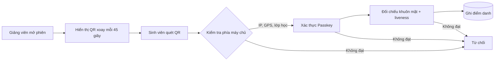

# Hệ thống điểm danh bằng mã QR

Ứng dụng web quản lý điểm danh trong lớp học, viết bằng **PHP** và **MySQL/MariaDB**. Giảng viên chiếu mã QR thay đổi liên tục, sinh viên quét mã trên điện thoại, và hệ thống kiểm tra thêm vị trí, mạng Wi-Fi, thiết bị và khuôn mặt trước khi ghi nhận điểm danh.

> Dự án được phát triển tiếp từ [SagarBhoi404/qr-code-attendance-system](https://github.com/SagarBhoi404/qr-code-attendance-system). Phiên bản này việt hoá giao diện, bổ sung xác thực thiết bị (Passkey), xác minh khuôn mặt và vá nhiều lỗi bảo mật.

## Mục lục

1. [Tính năng](#tính-năng)
2. [Cách điểm danh hoạt động](#cách-điểm-danh-hoạt-động)
3. [Các lớp bảo vệ](#các-lớp-bảo-vệ)
4. [Công nghệ sử dụng](#công-nghệ-sử-dụng)
5. [Cài đặt](#cài-đặt)
6. [Cấu hình](#cấu-hình)
7. [Kiểm thử](#kiểm-thử)
8. [Hạn chế đã biết](#hạn-chế-đã-biết)
9. [Checklist trước khi chạy thật](#checklist-trước-khi-chạy-thật)
10. [Thư viện bên thứ ba](#thư-viện-bên-thứ-ba)

## Tính năng

Hệ thống có ba vai trò, mỗi vai trò thấy một giao diện riêng.

| Vai trò | Chức năng chính |
|---|---|
| **Quản trị viên** | Thêm, xem, sửa sinh viên, giảng viên, môn học và thời khóa biểu. Xem và quản lý toàn bộ bản ghi điểm danh, kể cả điểm danh thủ công khi quét lỗi. Duyệt hoặc thu hồi thiết bị Passkey của sinh viên, duyệt hoặc đặt lại hồ sơ khuôn mặt. Cấu hình dải IP Wi-Fi của trường. |
| **Giảng viên** | Mở phiên điểm danh cho lớp được phân công và hiển thị mã QR xoay tự động. Xem điểm danh của lớp mình. |
| **Sinh viên** | Quét mã QR trong giờ học, xác thực bằng Passkey (vân tay, Face ID, Windows Hello) và đối chiếu khuôn mặt. Xem lịch sử điểm danh của bản thân. |

## Cách điểm danh hoạt động



Máy chủ quyết định mọi bước. Trình duyệt chỉ gửi dữ liệu thô (mã QR, tọa độ, kết quả xác thực), không tự quyết định kết quả điểm danh.

## Các lớp bảo vệ

| Lớp | Mô tả |
|---|---|
| **QR xoay vòng** | Mã là chuỗi ngẫu nhiên, máy chủ chỉ lưu bản băm SHA-256. Mặc định hết hạn sau 45 giây (`qr_rotate_seconds`). Mã được vẽ hoàn toàn ở trình duyệt, không gọi dịch vụ bên ngoài. |
| **Wi-Fi của trường** | Máy chủ so IP của sinh viên (lấy từ `REMOTE_ADDR`, trình duyệt không tự gửi được) với danh sách dải mạng `campus_cidrs`. |
| **GPS** | Kiểm tra khoảng cách tới tâm trường và độ chính xác của tín hiệu. Đây là tín hiệu bổ trợ, không phải chốt chặn duy nhất. |
| **Passkey (WebAuthn)** | Sinh viên xác thực bằng sinh trắc học của thiết bị đã được quản trị viên duyệt. Mỗi sinh viên có tối đa `max_devices` thiết bị (mặc định 2). |
| **Khuôn mặt + liveness** | Đối chiếu vector khuôn mặt với hồ sơ đã được duyệt, kèm thử thách chớp mắt hoặc quay đầu dùng một lần. |
| **Chống điểm danh trùng** | Mỗi sinh viên chỉ có một lượt cho mỗi phiên (ràng buộc UNIQUE ở bảng `attendance_claims`), và hệ thống kiểm tra trùng theo ngày, môn, tiết trước khi ghi. |
| **Bảo vệ yêu cầu** | Thao tác ghi dữ liệu bắt buộc dùng phương thức POST và mã CSRF. Truy vấn dùng prepared statement. Đăng nhập tạo lại session và bị giới hạn số lần thử sai theo từng cặp (tài khoản, IP). |
| **Mật khẩu** | Mật khẩu mới dùng `password_hash()`. Mật khẩu cũ (MD5) vẫn đăng nhập được và tự nâng cấp sau lần đăng nhập thành công. |

## Công nghệ sử dụng

- **Backend:** PHP 8.0 trở lên, MySQL hoặc MariaDB, không dùng framework.
- **Xác thực thiết bị:** WebAuthn / FIDO2 (thư viện `lbuchs/WebAuthn`).
- **Khuôn mặt:** `face-api.js` chạy trong trình duyệt.
- **Giao diện:** Bootstrap, jQuery, DataTables, Font Awesome.

## Cài đặt

### Yêu cầu

- Web server có PHP 8.0+ và MySQL/MariaDB (ví dụ XAMPP, WAMP, LAMP).
- HTTPS khi chạy thật (WebAuthn bắt buộc). Trên `localhost` có thể dùng HTTP để phát triển.

### Các bước

**1. Lấy mã nguồn**

```bash
git clone https://github.com/phamhuuhung17082004/QR-code-attendance-system.git
cd QR-code-attendance-system
```

**2. Tạo cơ sở dữ liệu**

Tạo CSDL tên `qrattendance`, sau đó nhập lần lượt **đủ 4 file** theo đúng thứ tự:

```bash
mysql -u root -p qrattendance < database.sql
mysql -u root -p qrattendance < database_security_migration.sql
mysql -u root -p qrattendance < database_passkey_migration.sql
mysql -u root -p qrattendance < database_face_approval_migration.sql
```

> Thiếu file thứ 4 sẽ làm trang quản lý thiết bị của quản trị viên và chức năng đăng ký khuôn mặt báo lỗi 500, vì bảng `student_face_profiles` chưa có cột `status`.

**3. Tạo file cấu hình `.env`** ở thư mục gốc (không đưa file này lên Git):

```ini
DB_HOST=localhost
DB_USER=root
DB_PASS=your_password
DB_NAME=qrattendance
# Tùy chọn: Relying Party ID cho WebAuthn (mặc định theo tên máy chủ)
WEBAUTHN_RP_ID=localhost
```

**4. Triển khai**

Đặt mã nguồn vào thư mục gốc của web server (ví dụ `htdocs` của XAMPP) và truy cập `http://localhost/QR-code-attendance-system`.

**Tài khoản quản trị mặc định:** `admin` / `123`. **Hãy đổi mật khẩu ngay sau lần đăng nhập đầu tiên.**

## Cấu hình

Các thiết lập nằm trong bảng `app_config` (dạng khóa - giá trị). Quản trị viên chỉnh được một phần trong menu **Cài đặt**, phần còn lại chỉnh bằng SQL.

| Khóa | Mặc định | Ý nghĩa |
|---|---|---|
| `campus_cidrs` | *(rỗng)* | Danh sách dải IP Wi-Fi của trường, cách nhau bằng dấu phẩy. **Để trống thì bỏ qua kiểm tra IP.** |
| `passkey_mode` | `always` | `always` bắt buộc Passkey, `off` tắt. |
| `require_device_approval` | `1` | `1` nghĩa là thiết bị và hồ sơ khuôn mặt mới phải được quản trị viên duyệt. |
| `max_devices` | `2` | Số thiết bị tối đa của mỗi sinh viên. |
| `qr_rotate_seconds` | `45` | Thời gian sống của mỗi mã QR (30 đến 180 giây). |
| `face_mode` | `always` | `off`, `flag` hoặc `always`. |
| `face_threshold` | `0.50` | Khoảng cách khuôn mặt tối đa được coi là cùng một người. |
| `geo_max_accuracy_m` | `100` | Sai số GPS tối đa cho phép, tính bằng mét. |

Ví dụ đặt dải mạng của trường bằng SQL:

```sql
INSERT INTO app_config (k, v) VALUES ('campus_cidrs', '203.0.113.0/24,2001:db8::/48')
ON DUPLICATE KEY UPDATE v = VALUES(v);
```

Tâm trường và bán kính điểm danh (cột `covarage`, đơn vị km) chỉnh trong menu **Cài đặt** của quản trị viên.

## Kiểm thử

Kiểm tra cú pháp toàn bộ mã PHP:

```bash
for f in *.php lib/*.php tests/*.php; do php -l "$f" || exit 1; done
```

Chạy các bài kiểm thử không cần CSDL:

```bash
php tests/ip_cidr_test.php
php tests/verification_test.php
```

Chạy các bài kiểm thử cần CSDL. **Hãy dùng một CSDL riêng để thử** (ví dụ `qrattendance_test`, khai báo trong `.env`), không dùng CSDL đang vận hành:

```bash
QRCAS_RUN_DB_TESTS=1 php tests/session_expiry_test.php
QRCAS_RUN_DB_TESTS=1 php tests/duplicate_attendance_test.php
QRCAS_RUN_DB_TESTS=1 php tests/login_lockout_test.php
```

## Hạn chế đã biết

Hệ thống chống tốt các kiểu gian lận thông thường (chụp QR gửi bạn, điểm danh từ xa, quét hộ không qua camera). Hệ thống **không** chống được người cố tình và có kỹ thuật. Cụ thể:

- **Khuôn mặt xử lý phía trình duyệt.** Vector khuôn mặt và thử thách liveness do `face-api.js` chạy trên máy sinh viên, nên có thể bị can thiệp bằng webcam ảo hoặc gửi vector giả. Cơ chế này không thay thế việc giảng viên giám sát trực tiếp tại lớp.
- **GPS có thể bị giả.** Tọa độ do trình duyệt báo cáo. Khi `campus_cidrs` để trống, GPS gần như là kiểm tra vị trí duy nhất.
- **Passkey đồng bộ đám mây.** Passkey lưu trong iCloud Keychain hoặc Google Password Manager có thể dùng được trên thiết bị khác đăng nhập cùng tài khoản đám mây.
- **Một điện thoại giữ nhiều tài khoản.** Nếu quản trị viên duyệt passkey của nhiều tài khoản trên cùng một điện thoại, điện thoại đó có thể điểm danh hộ cho các tài khoản ấy.
- **Hai phiên trong cùng một tiết.** Bảng `attendance` chưa có ràng buộc UNIQUE ở mức cơ sở dữ liệu, nên trong trường hợp hiếm hai yêu cầu đến cùng lúc ở hai phiên khác nhau, vẫn có thể phát sinh bản ghi trùng.
- **Sinh viên dùng 4G/5G.** Khi bật `campus_cidrs`, sinh viên dùng mạng di động sẽ bị từ chối (HTTP 403) và phải kết nối Wi-Fi của trường.
- **Chưa có chức năng đóng phiên thủ công.** Phiên chỉ kết thúc khi hết hạn.

## Checklist trước khi chạy thật

Hoàn thành đủ các mục sau trước khi đưa vào sử dụng thực tế:

- [ ] **Đổi mật khẩu mặc định.** Đổi mật khẩu `admin` (`123`), đồng thời xóa hoặc đổi mật khẩu các tài khoản mẫu (sinh viên `147501`, `147502`, giảng viên mã `3`).
- [ ] **Cập nhật tọa độ và bán kính.** Dữ liệu mẫu trong `database.sql` là tọa độ ở Ấn Độ. Nếu không đổi, mọi sinh viên sẽ bị từ chối vì nằm ngoài khu vực cho phép.
- [ ] **Điền `campus_cidrs`.** Đây là lớp phòng vệ quan trọng chống điểm danh từ xa và dùng 4G/5G.
- [ ] **Bật HTTPS và đặt `WEBAUTHN_RP_ID`** đúng với tên miền thật (ví dụ `attendance.university.edu.vn`). Thiếu bước này Passkey sẽ không hoạt động ngoài `localhost`.
- [ ] **Đồng bộ múi giờ.** Đặt PHP và MySQL cùng múi giờ `Asia/Ho_Chi_Minh` (UTC+7). Ứng dụng đã tự đặt múi giờ khi kết nối, nhưng cấu hình đúng từ gốc giúp tránh lệch thời gian hết hạn của mã QR và phiên điểm danh.
- [ ] **Sao lưu CSDL** trước khi chạy bất kỳ file migration nào trên dữ liệu thật.
- [ ] **Không đưa `.env` lên Git** và không để lộ thư mục `uploads/`.

## Thư viện bên thứ ba

Các thư viện sau được đưa trực tiếp vào mã nguồn, đều theo giấy phép MIT.

| Thư viện | Vị trí | Nguồn |
|---|---|---|
| lbuchs/WebAuthn v2.2.0 | `lib/webauthn/` | [github.com/lbuchs/WebAuthn](https://github.com/lbuchs/WebAuthn) |
| qrcodejs | `js/vendor/qrcode.min.js` | [github.com/davidshimjs/qrcodejs](https://github.com/davidshimjs/qrcodejs) |
| Instascan | `js/vendor/instascan.min.js` | [github.com/schmich/instascan-builds](https://github.com/schmich/instascan-builds) |
| Trọng số mô hình face-api.js | `lib/face-api/models/` | [github.com/justadudewhohacks/face-api.js](https://github.com/justadudewhohacks/face-api.js) |
